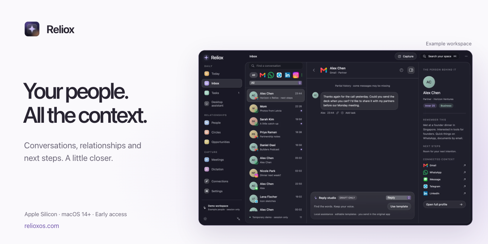

<a href="https://www.relioxos.com/">
  
</a>

# Reliox

**A little space. For your people.**

Conversations, the details you want to remember, and the follow-up you promised. Reliox brings them together in a calm workspace on your Mac.

Created by [Megan Martinsone](https://github.com/megandmartin). This repository contains the public website and Mac release distribution; the native app source is maintained separately.

[Visit the website](https://www.relioxos.com/) · [Download for Mac](https://www.relioxos.com/download/) · [Watch the walkthrough](https://www.relioxos.com/#watch-demo) · [Release notes](https://www.relioxos.com/releases/) · [Engineering notes](docs/ENGINEERING.md)

[](https://github.com/megandmartin/reliox-website/actions/workflows/checks.yml) [](https://github.com/megandmartin/reliox-website/releases/tag/v0.10.0) [](https://www.relioxos.com/download/)

## A person. The whole thread.

| In Reliox | What it helps you do |
| --- | --- |
| Conversations | Read selected or imported context beside notes and a reply draft. |
| People & circles | Keep the little details, relationship history, and follow-up preferences together. |
| Today & next steps | Give a promise a next step, with the original context close by. |
| Local workspace | Save your own workspace encrypted on your Mac; explore the temporary demo without connecting accounts. |

The [recorded walkthrough](https://www.relioxos.com/#watch-demo) uses example conversations. Read [how Reliox handles data](https://www.relioxos.com/privacy/) before bringing in your own context.

> [!IMPORTANT]
> **Mac early access:** Reliox 0.10.0 requires Apple Silicon and macOS 14 or later. The app is ad-hoc signed and **not Apple notarized**. Read the [installation guidance](https://www.relioxos.com/download/#install) and [release checksums](https://github.com/megandmartin/reliox-website/releases/tag/v0.10.0) before opening it. Optional connections and AI features need separate setup; live account compatibility is still being tested.

## About this repository

This is the public source for the Reliox website: the product introduction, download and installation guide, privacy explanation, and release notes. The Mac download is hosted in [GitHub Releases](https://github.com/megandmartin/reliox-website/releases).

The website is static HTML, CSS, and JavaScript, generated with Node.js. It has **no runtime or build dependencies**, accounts, analytics scripts, or data collection forms. Demo screenshots use synthetic data. The native Mac application source is maintained separately.

## Engineering

The [engineering notes](docs/ENGINEERING.md) explain the architecture, design tradeoffs, test coverage, and release boundaries, with links to the implementation.

Browser regression tests exercise the actual navigation, keyboard tabs, and media behavior. A separate [release verifier](docs/RELEASE-VERIFICATION.md) checks the public download without running it. Both are reproducible from this repository.

## Run it locally

Use **Node.js 22 or later**. No dependency installation is needed.

```sh
git clone https://github.com/megandmartin/reliox-website.git
cd reliox-website
npm run dev
```

Open [127.0.0.1:4173](http://127.0.0.1:4173). After editing source files, restart `npm run dev` to rebuild, then refresh your browser.

| Command | Purpose |
| --- | --- |
| `npm run dev` | Build the website and serve a local preview. |
| `npm test` | Build and check pages, links, release metadata, security headers, and preview-server behavior. |
| `npm run test:browser` | Run browser interaction checks after installing the test tooling. |
| `npm run verify:release` | Stream and verify the public Mac ZIP against its size and checksums. |
| `npm run build` | Generate the deployable website in `dist/`. |
| `npm start` | Serve an existing build. |

```text
src/site.mjs        Page content, templates, and site metadata
public/            Styles, scripts, approved screenshots, and films
scripts/           Static build, preview server, and checks
.github/           CI and contribution templates
docs/              Development notes and repository artwork
```

The build and Node checks need no install. Browser tests use a pinned development dependency; see [test setup](docs/ENGINEERING.md). See the [development guide](docs/DEVELOPMENT.md) for hosting, release updates, and video behavior.

## Help shape the next version

Clearer installation instructions, accessible interactions, responsive layouts, and useful bug reports all help. Start with the [contribution guide](CONTRIBUTING.md), check [open issues](https://github.com/megandmartin/reliox-website/issues), or [suggest an improvement](https://github.com/megandmartin/reliox-website/issues/new/choose).

The [website roadmap](docs/ROADMAP.md) covers captions, browser regression checks, and release verification.

- [Report a bug or share a feature idea](https://github.com/megandmartin/reliox-website/issues/new/choose).
- [Report a security vulnerability privately](SECURITY.md).

Public feedback should use example data. Keep private conversations, recordings, contact details, and credentials out of issues and pull requests.
