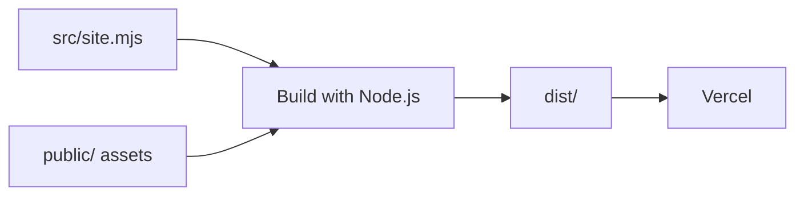

# Engineering notes

Reliox's public website connects the product demo, Mac download, installation guidance, privacy explanation, and release notes. The implementation is a static site with small browser scripts and versioned release metadata.

## From source to a page



[`scripts/build.mjs`](../scripts/build.mjs) renders the home, download, privacy, release, and film transcript pages, then copies public assets and generates crawler files. [`src/site.mjs`](../src/site.mjs) contains the templates and shared layout. [`src/films.mjs`](../src/films.mjs) provides recorded-film text and caption references. [`vercel.json`](../vercel.json) defines production redirects, response headers, and cache rules.

Visitors receive the static files from Vercel. The `/download/mac/` route redirects to the versioned ZIP on GitHub Releases, keeping the app download separate from the website deployment.

The local preview uses [`scripts/serve.mjs`](../scripts/serve.mjs); production serves the exported files through Vercel. Preview-server tests establish local HTTP behavior. Production configuration and live hosting need their own checks.

## Design choices and tradeoffs

| Choice | What it provides | Tradeoff or boundary |
| --- | --- | --- |
| Static generation with Node.js | The product description and download guidance arrive as complete HTML. The build needs no third-party packages. | Source changes require a rebuild. The local preview does not watch files. |
| Progressive browser interactions | Navigation, experience tabs, and video controls use small scripts in `public/`. The main page content and download links remain in HTML. | Interaction behavior needs browser tests in addition to generated-HTML checks. The enhanced experience tabs require JavaScript. |
| Self-hosted films | Native media controls, posters, direct-file links, and byte-range seeking. No third-party video player. | Films are substantial assets. The walkthrough waits for an explicit play; permitted hero autoplay still transfers media. |
| Versioned Mac release assets | A specific release URL, file size, and checksum can be checked independently of the website build. | Release artifacts need their own integrity and signing checks. Hash agreement confirms matching bytes. |
| A separate browser-test dependency | The build and ordinary Node checks stay dependency-free; browser behavior is tested with pinned Playwright tooling. | Browser checks require an install and browser binaries. The lockfile records the test dependency tree. |

## Behavior worth inspecting

[`public/main.js`](../public/main.js) synchronizes the experience tabs' selected state, keyboard focus, and panel visibility. It also handles mobile navigation and progressively fills release details from [`public/release.json`](../public/release.json).

[`public/video.js`](../public/video.js) coordinates the two players. Visibility, reduced motion, data saving, manual pauses, and active playback affect whether the hero can preview. Explicit playback pauses the other player. Media failures leave a retry and direct-file path available.

The release version and URLs appear in page metadata, hosting redirects, and the preview server. Automated contract checks catch disagreement. Release updates still require a maintainer to update and review these sources together; they are not generated from one configuration file today.

## Reproduce the checks

With Node.js 22 or later:

```sh
npm test
```

This builds the site and runs dependency-free checks against exported pages, links, metadata, hosting configuration, documentation, preview HTTP behavior, and release-verifier failure cases. The release-verifier tests use small synthetic HTTP responses. They do not download the Mac app.

For browser checks:

```sh
npm ci
npx playwright install chromium webkit
npm run test:browser
```

The browser suite covers Chromium and WebKit at desktop and emulated phone widths. It exercises navigation, keyboard tabs, overflow, reduced-motion playback, video coordination, caption loading and selection, transcript links, and download routing. A phone viewport is not a real-device test; WebKit automation is not a complete Safari acceptance test. CI installs the browser system dependencies on Linux and retains failure evidence for debugging.

For the public release, run the separate opt-in check:

```sh
npm run verify:release
```

That command streams the published ZIP, checks byte length and SHA-256 against the manifest and `SHA256SUMS`, and discards the bytes. It does not open or execute the app. See [release verification](RELEASE-VERIFICATION.md).

## Verification coverage

| Evidence | What it establishes |
| --- | --- |
| [Automated checks](https://github.com/megandmartin/reliox-website/actions/workflows/checks.yml) | The checked commit meets the assertions in the source and browser suites. |
| [Recorded walkthrough](https://www.relioxos.com/#watch-demo) | A recorded view of the app using example conversations. |
| [Versioned release](https://github.com/megandmartin/reliox-website/releases/tag/v0.9.0) | A downloadable early-access Mac build, with published compatibility and signing limits. |
| A successful release-integrity check | The downloaded bytes match the published size and hashes at the time of the check. |

Website checks cover the contracts described above. Mac installation, account compatibility, recording permissions, and longer-term use need their own product acceptance checks. See the [website roadmap](ROADMAP.md) for the remaining public-site work.
